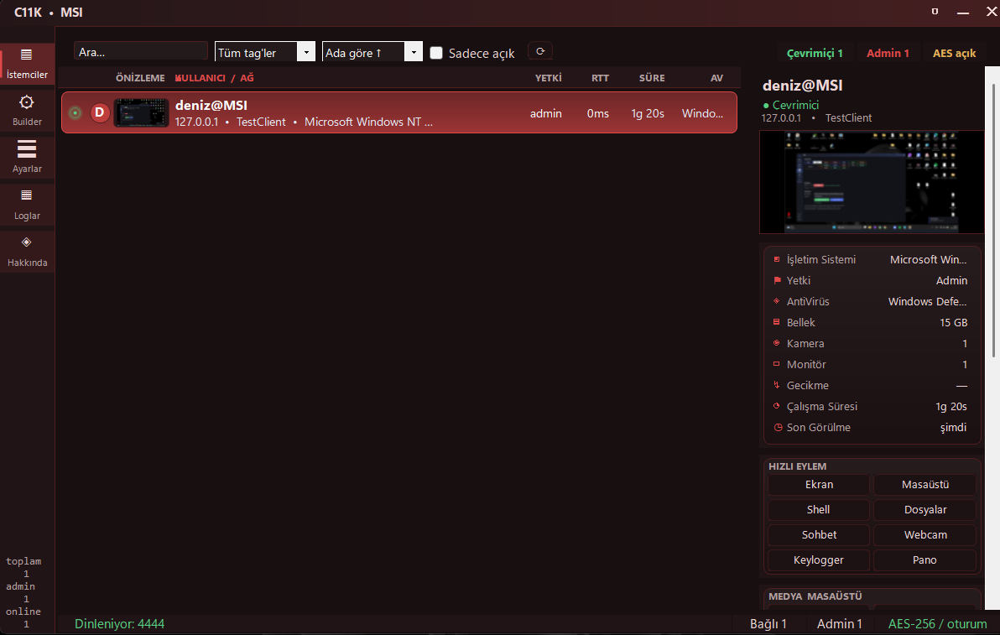
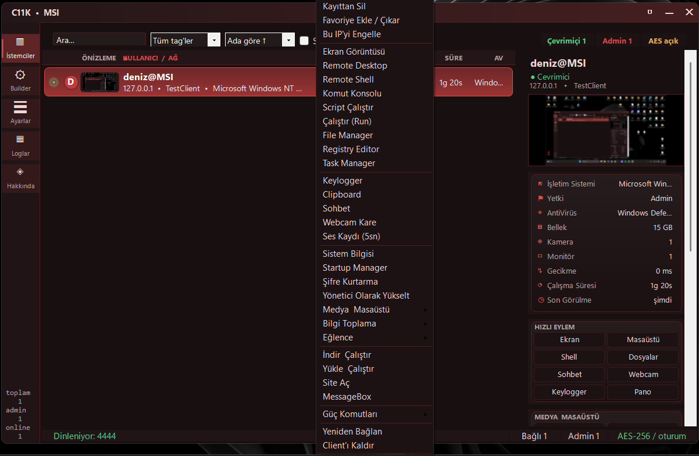
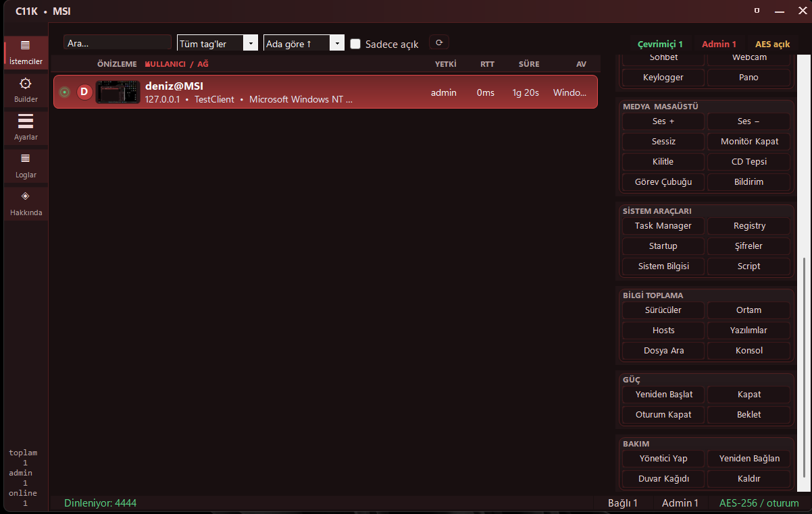

# C11K

> **⚠️ Proje durumu:** Bu proje **henüz tamamlanmadı**. Aktif geliştirme aşamasında ve **kısa süre içinde halka açık** olarak yayınlanacak. O zamana kadar kod, dokümantasyon ve özellikler değişebilir.

<p align="center">
  
</p>

<p align="center">
  <i>C11K ana arayüz — istemci ızgarası, canlı önizleme ve sağ panel hızlı eylemler</i>
</p>

---

**C11K**, C# WinForms ile yazılmış, tek dosyada çalışan bir uzaktan erişim aracıdır. İçinde **builder**, **server** ve **Telegram botu** bir arada bulunur — harici bağımlılık yoktur, .NET Framework ile derlenir.

---

## 📌 İçindekiler

- [Özellikler](#-özellikler)
- [Mimari](#️-mimari)
- [Gelişmiş Yetenekler](#-gelişmiş-yetenekler)
- [Açık Kaynak](#-açık-kaynak)
- [Bilinen Sınırlamalar](#-bilinen-sınırlamalar)
- [Kurulum](#️-kurulum)
- [Kullanım](#-kullanım)
- [Telegram Botu](#-telegram-botu)
- [Yol Haritası](#️-yol-haritası)
- [Uyarı](#️-uyarı)

---

## ✨ Özellikler

### 🖥️ Uzaktan Kontrol
- **Canlı masaüstü** — fare kontrolü, çoklu monitör, kalite seçimi (düşük/orta/yüksek)
- **Ekran görüntüsü** — tek tıkla anlık kare
- **Remote Shell** — cmd üzerinden komut çalıştırma
- **Script çalıştırıcı** — PowerShell ve Batch desteği (encoded command ile)
- **Komut konsolu** — tek istemci veya tüm istemcilere toplu komut
- **Dosya yöneticisi** — gezinme, indirme, yükleme, silme, klasör oluşturma, arama
- **Registry editör** — anahtar okuma
- **Startup yöneticisi** — ekleme/kaldırma
- **Süreç yöneticisi** — listeleme, sonlandırma, başlatma

### 🎥 Medya & Casusluk
- **Webcam** — tek kare çekim
- **Ses kaydı** — ayarlanabilir süre (1–60 sn), WAV çıktısı
- **Keylogger** — aktif pencere başlığıyla birlikte
- **Pano izleme** — otomatik veya manuel okuma/yazma
- **Şifre kurtarma** — Chrome / Edge / Brave + WiFi profilleri (DPAPI + AES-GCM)
- **Sohbet** — çift yönlü, tek taraflı kapatma (istemci kapatamaz)
- **Toast bildirimi** — sağ altta özel mesaj
- **MessageBox** — istemcide başlık/metin/ikon seçilebilir kutu

### 🎛️ Sistem Kontrolü
- **Ses** — arttır / azalt / sessize al
- **Monitör** — kapatma
- **Kilit** — iş istasyonunu kilitle
- **CD tepsisi** — aç/kapat
- **Görev çubuğu** — gizle/göster
- **Masaüstü ikonları** — gizle/göster
- **Duvar kağıdı** — resim göndererek değiştirme
- **Güç** — yeniden başlat / kapat / oturum kapat / bekleme
- **Bip** — sistem beep sesi

### 🔧 Builder
- **Kimlik** — client tag, process mutex, AES anahtarı
- **Bağlantı** — host, port, fallback host, heartbeat, SOCKS5 proxy (kullanıcı/şifre)
- **Kurulum** — kurulum yolu, gizli dosya, kalıcılık yöntemi (Registry / Startup / Task / Boot / Service), anti-VM, anti-debug, firewall istisnası
- **Yükseltme** — sessiz UAC yükseltme, gecikme
- **Derleme** — ürün adı, şirket, sürüm, obfuscation (base64 string), UPX sıkıştırma, loader stub
- **İzleme** — otomatik keylogger / pano / remote desktop başlatma, log klasörü

### 🎨 Arayüz
- **19 tema** — Slate, Beyaz, Kırmızı, Pembe, Mavi, Yeşil, Turuncu, Mor, Sarı, Turkuaz, Lacivert, Bordo, Gri, Zümrüt, Altın, Gül, Kahve, Mint, Neon
- **İstemci ızgarası** — önizleme, RTT, uptime, yetki, AV durumu, çevrimiçi/çevrimdışı
- **Arama & filtre** — ada, IP'ye, tag'e, RTT'ye, yetkiye göre sıralama
- **Favoriler & engelleme** — kayıt tutma, IP engelleme
- **Bildirimler** — toast + Telegram
- **Log paneli** — renkli, zaman damgalı, kaydetme/kopyalama

---

## 🏗️ Mimari

C11K üç ayrı bileşenden oluşur ve hepsi **tek bir C# dosyasında** (`Form1.cs`) yaşar. Builder, server ve bot aynı süreçte çalışır; client ise builder tarafından **runtime'da derlenen** ayrı bir `.exe`'dir.

```
┌──────────────────────────────────────────────────────────────────────┐
│                        C11K SERVER (WinForms)                        │
│                                                                      │
│  ┌────────────┐   ┌────────────┐   ┌────────────┐   ┌────────────┐   │
│  │  Builder   │   │  Session   │   │  Telegram  │   │   Module   │   │
│  │  Panel     │   │  Manager   │   │    Bot     │   │  Registry  │   │
│  └─────┬──────┘   └─────┬──────┘   └─────┬──────┘   └─────┬──────┘   │
│        │                │                │                │          │
│        │ CSharpCode     │ TcpListener    │ HTTPS          │ Form     │
│        │ Provider       │ + Protocol     │ (Bot API)      │ cache    │
│        ▼                ▼                ▼                ▼          │
│  ┌──────────────────────────────────────────────────────────────┐    │
│  │              Protocol (frame + crypto katmanı)               │    │
│  └──────────────────────────┬───────────────────────────────────┘    │
└─────────────────────────────┼────────────────────────────────────────┘
                              │
              TCP · AES-256-CBC + HMAC-SHA256
              PBKDF2(40k) · oturum tuzu · 96 MB frame
                              │
┌─────────────────────────────┼────────────────────────────────────────┐
│                    C11K CLIENT (derlenmiş .exe)                      │
│                                                                      │
│  ┌────────────┐   ┌────────────┐   ┌────────────┐   ┌────────────┐   │
│  │  Connect   │   │  Dispatch  │   │  Modules   │   │  Persist   │   │
│  │  Loop      │   │  (cmd      │   │  (RD/KL/   │   │  (Reg/     │   │
│  │  + SOCKS5  │   │   parser)  │   │   Clip/..) │   │   Task/..) │   │
│  └─────┬──────┘   └─────┬──────┘   └─────┬──────┘   └─────┬──────┘   │
│        └────────────────┴────────────────┴────────────────┘          │
│                              │                                       │
│              Win32 API (user32/gdi32/avicap32/winmm)                 │
│              DPAPI + BCrypt (şifre kurtarma)                         │
│              sqlite3 (Chromium Login Data)                           │
└──────────────────────────────────────────────────────────────────────┘
                              │
                              │ HTTPS (Bot API)
                              ▼
                    ┌──────────────────┐
                    │  Operatör        │
                    │  (Telefon / PC)  │
                    └──────────────────┘
```

---

### 🧩 Bileşenler ve Sorumlulukları

| Bileşen | Sınıf / Dosya | Görevi | Kullandığı Teknoloji |
|---|---|---|---|
| **UI çatısı** | `DarkForm`, `ChromeButton`, `Theme` | Özel çizilmiş pencere, 19 tema, DWM dark title bar, rounded corners | `user32`, `dwmapi`, `uxtheme` P/Invoke |
| **Builder** | `BuilderPanel`, `Builder`, `BuildConfig` | Kullanıcıdan ayar topla, `PayloadTemplate.Source` içine enjekte et, derle | `Microsoft.CSharp.CSharpCodeProvider` (`csc` in-process) |
| **Payload** | `PayloadTemplate.Source` | Client'in tam kaynak kodu — placeholder (`%%HOST%%`, `%%AESKEY%%` …) ile gelir | C# string template |
| **Session Manager** | `SessionManager` | `TcpListener` (dual-mode), oturum sözlüğü, heartbeat sweep | `System.Net.Sockets` |
| **Protokol** | `Protocol`, `SessionCrypto` | Frame okuma/yazma, AES + HMAC, salt üretimi | `System.Security.Cryptography` |
| **Telegram Bot** | `TgBot`, `Json` (mini parser), `Notify` | Long polling, inline butonlar, dosya indirme/yükleme | `HttpWebRequest`, `WebClient` |
| **Modül kaydı** | `ModuleRegistry`, `IRemoteModule` | Aynı istemci için aynı pencereyi tekrar açma, tema senkronu | Generic `ConcurrentDictionary` |
| **İstemci tarafı** | `GeneratedClient.Program` (template) | Bağlantı döngüsü, komut dispatch, tüm casusluk modülleri | Win32 P/Invoke, WMI, DPAPI, BCrypt |
| **Depolama** | `Storage` | Favoriler, engelliler, bilinen istemciler, Telegram token | `%AppData%\C11K\` düz metin |
| **Görselleştirme** | `ClientGrid`, `InfoRow`, `Bubble`, `Toast` | Özel çizilmiş istemci ızgarası, sohbet balonları, bildirimler | GDI+ (`System.Drawing`) |

---

### 🔄 Veri Akışı — Adım Adım

**1. Builder → Client (derleme anı)**

```
BuilderPanel.Collect()  →  BuildConfig
        │
        ▼
Builder.Build(cfg, outPath)
        │  %%HOST%%, %%AESKEY%%, %%PORT%% … placeholder'ları değiştirir
        │  obfuscation açıksa → D("base64") çağrısına çevirir
        ▼
CSharpCodeProvider.CompileAssemblyFromSource()
        │
        ├── UseLoader=false → doğrudan OneDrive.exe
        └── UseLoader=true  → önce DLL derle, base64'e çevir, stub'a göm, stub'ı derle
        │
        ▼
(opsiyonel) upx.exe --best
```

**2. Client → Server (bağlantı kurulumu)**

```
Client                              Server
  │                                   │
  │──── TCP connect ─────────────────►│
  │──── HELLO|sid|tag|user@pc|... ───►│  (düz metin)
  │                                   │  SessionManager.Handle()
  │◄─── SALT|<base64-16byte> ─────────│  (düz metin, sunucu üretir)
  │                                   │
  │  key = AESKEY + "|" + SALT        │  key = AESKEY + "|" + SALT
  │  PBKDF2(40k) → enc(32) + mac(32)  │  PBKDF2(40k) → enc(32) + mac(32)
  │                                   │
  │◄═══ AES-256-CBC + HMAC ══════════►│  (artık her şey şifreli)
  │                                   │
```

**3. Komut gönderme (server → client)**

```
UI (QuickAction)  →  SessionManager.Send(sid, "SHOT")
        │
        ▼
Protocol.Write(stream, "SHOT", key)
        │  aes.Encrypt("SHOT") → IV + cipher + MAC
        │  5-byte header: [len][flag=1]
        ▼
Client Recv() → Decrypt → Dispatch("SHOT") → ShotOnce()
        │
        ▼
Send("SHOT|1920|1080|<base64 jpeg>")
        │
        ▼
Server MessageIn() → OnShot() → thumbnail üret → ClientGrid.UpdateRow()
```

**4. Telegram botu (paralel kanal)**

```
Operatör ──/shot──► Telegram API ──getUpdates──► TgBot.Poll()
                                                       │
                                                       ▼
                                              Handle() → Cmd("/shot")
                                                       │
                                                       ▼
                                              _mgr.Send(sid, "SHOT")
                                                       │
                                        (client cevabı gelince)
                                                       │
                                                       ▼
                                              TgBot.Feed(sid, msg)
                                                       │
                                                       ▼
                                              Photo(chat, b64, caption)
                                                       │
                                                       ▼
                                              Operatör ◄── sendPhoto
```

---

### 🧰 Kullanılan Teknolojiler ve Nedenleri

**Dil & Framework**
- **C# / .NET Framework 4.7.2+** — tek dosyada WinForms, P/Invoke ve runtime derleme bir arada
- **WinForms** — özel çizim (`OnPaint`) ile tema sistemi, harici UI kütüphanesi yok
- **GDI+** (`System.Drawing`) — tüm özel kontroller, ekran görüntüsü işleme, JPEG encode

**Ağ & Protokol**
- **`System.Net.Sockets.TcpListener` / `TcpClient`** — dual-mode IPv6/IPv4, `NoDelay`, `KeepAlive`
- **`System.Security.Cryptography`** — `Aes`, `HMACSHA256`, `Rfc2898DeriveBytes` (PBKDF2)
- **SOCKS5** — elle yazılmış RFC 1928 implementasyonu (kullanıcı/şifre auth dahil)

**Runtime Derleme**
- **`Microsoft.CSharp.CSharpCodeProvider`** — in-process `csc`, harici SDK gerektirmez
- **`CompilerParameters`** — `/target:winexe`, `/optimize+`, `/target:library` (loader için)
- **Loader stub** — payload'ı base64 olarak gömer, `Assembly.Load(byte[])` ile bellekte açar

**Windows Entegrasyonu (P/Invoke)**
| DLL | Kullanım |
|---|---|
| `user32.dll` | `SendMessage`, `GetAsyncKeyState`, `ToUnicodeEx`, `LockWorkStation`, `SetCursorPos`, `mouse_event`, `keybd_event`, `SystemParametersInfo` |
| `gdi32.dll` | `BitBlt`, `CreateDC`, `DeleteDC` — ekran yakalama |
| `dwmapi.dll` | `DwmSetWindowAttribute` — dark title bar, rounded corners |
| `uxtheme.dll` | `SetWindowTheme` — ListView dark mode |
| `avicap32.dll` | `capCreateCaptureWindowA` — webcam |
| `winmm.dll` | `mciSendString` — ses kaydı, CD tepsi |
| `crypt32.dll` | `CryptUnprotectData` — DPAPI çözme |
| `bcrypt.dll` | `BCryptDecrypt` — AES-GCM (Chromium v10 şifreleri) |
| `winsqlite3.dll` | `sqlite3_*` — Chromium `Login Data` okuma |

**Sistem Bilgisi**
- **`System.Management` (WMI)** — `Win32_OperatingSystem` (RAM), `Win32_PnPEntity` (kamera), `root\SecurityCenter2` (AV)
- **`Microsoft.Win32.Registry`** — kalıcılık, anti-VM tespiti, startup yönetimi
- **`Process` / `ProcessStartInfo`** — shell, script, güç komutları

**Telegram**
- **`HttpWebRequest` / `WebClient`** — `getUpdates` long polling, `sendMessage`, `sendPhoto`, `sendDocument`, `getFile`
- **`multipart/form-data`** — elle yazılmış boundary encoder
- **Mini JSON parser** — `System.Text.Json` bağımlılığı yok, ~200 satır elle yazılmış

**Şifre Kurtarma**
- **DPAPI** (`CryptUnprotectData`) — Chromium `encrypted_key` çözme
- **BCrypt AES-GCM** — Chromium v10+ şifreleri
- **SQLite P/Invoke** — `Login Data` dosyasını kopyalayıp okuma (kilitli dosya sorunu için)
- **`netsh wlan`** — WiFi profilleri

**Görsel / UI**
- **`LinearGradientBrush`, `GraphicsPath`** — kartlar, butonlar, balonlar
- **`Control.SetStyle`** — `DoubleBuffered`, `UserPaint`, `AllPaintingInWmPaint` (flicker yok)
- **`TextRenderer` / `Graphics.DrawString`** — ClearType rendering

**Opsiyonel**
- **UPX** — `--best` sıkıştırma (harici `upx.exe`)

---

### 📐 Protokol Detayı

**Frame yapısı:**
```
┌────────┬────────┬────────┬────────┬────────┬─────────────────────┐
│ len[0] │ len[1] │ len[2] │ len[3] │ flag   │ body[len]           │
│ (LE32 toplam uzunluk)          │ 0/1    │                     │
└────────┴────────┴────────┴────────┴────────┴─────────────────────┘

flag=0  →  body = UTF-8 düz metin
flag=1  →  body = IV[16] + cipher[..] + HMAC[32]
```

**Şifreli gövde:**
```
IV (16 byte, rastgele)
Cipher (AES-256-CBC, PKCS7, plaintext UTF-8)
HMAC-SHA256(IV || Cipher)  →  32 byte
```

**Doğrulama:** HMAC sabit zamanlı karşılaştırma (`diff |= mac[i] ^ body[...]`) — timing attack'a dirençli.

**Sınırlar:**
- Maksimum frame: `96 * 1024 * 1024` (96 MB)
- PBKDF2 iterasyon: `40000`
- Heartbeat: min 10 sn, varsayılan 60 sn
- Sessizlik timeout: 150 sn → oturum düşer

---

### 🗂️ Dosya Yapısı (tek dosya içinde)

```
Form1.cs
├── Native              → P/Invoke imzaları
├── Ui                  → font, renk, rounded path, shadow yardımcıları
├── BufferedPanel       → flicker'sız Panel
├── BufferedListView    → double-buffered ListView
├── PillButton          → animasyonlu buton
├── CardPanel           → gradient + shadow kart
├── InfoRow             → ikon + caption + değer satırı
├── SearchBox           → placeholder'lı arama kutusu
├── Bubble              → sohbet balonu
├── Storage             → %AppData%\C11K\ dosya I/O
├── Notify              → Telegram bildirim
├── Json                → mini JSON parser
├── TgBot               → Telegram bot (poll, cmd, callback)
├── Theme               → 19 tema tanımı
├── ChromeButton        → kapat/küçült/büyüt
├── DarkForm            → özel title bar + resize
├── DarkGroup           → başlıklı kart
├── BuildConfig         → builder ayarları
├── ClientSession       → oturum modeli
├── SessionCrypto       → AES + HMAC sarmalayıcı
├── Protocol            → frame oku/yaz
├── PayloadTemplate     → client kaynak kodu (string)
├── Builder             → derleme + loader + UPX
├── SessionManager      → TcpListener + oturum yönetimi
├── IRemoteModule       → modül arayüzü
├── ModuleRegistry      → açık pencerelerin kaydı
├── ModuleForm          → modül tabanı
├── CamForm / DesktopViewerForm / RemoteShellForm / ...
├── ChatForm / ConsoleForm / InfoTextForm / ScriptForm / ...
├── FileManagerForm / TaskManagerForm / SystemInfoForm / ...
├── RegistryEditorForm / StartupManagerForm / KeyloggerForm / ...
├── ClipboardForm / PasswordForm / MessageBoxForm
├── Toast               → bildirim penceresi
├── RailButton          → sol ray düğmesi
├── ClientGrid          → istemci ızgarası
├── PreviewForm         → büyük önizleme
├── ClientsPanel        → istemci paneli + drawer
├── LogsPanel           → renkli log
├── DarkRenderer / DarkTable
├── BuilderPanel        → 5 sekmeli builder
├── SettingsPanel       → tema + port + Telegram
└── Form1               → ana pencere, hepsini bağlar
```

---

### ⚖️ Tasarım Kararları

| Karar | Neden |
|---|---|
| **Tek dosya** | Taşıması kolay, builder kendi kaynağını derleyebilir, DLL cehennemi yok |
| **Runtime `csc`** | Kullanıcıdan Visual Studio istemez, tek exe ile client üretir |
| **String template** | `%%HOST%%` gibi placeholder'lar okunabilir, obfuscation opsiyonel |
| **Mini JSON** | `System.Text.Json` .NET Framework 4.7.2'de yok, Newtonsoft bağımlılığı istemedik |
| **PBKDF2 + SALT** | Aynı AES anahtarı farklı oturumlarda farklı session key üretir |
| **Encrypt-then-MAC** | Padding oracle'a dirençli, HMAC önce doğrulanır |
| **Sabit zamanlı HMAC** | Timing attack engeli |
| **Dual-mode TCP** | IPv6 ve IPv4 aynı portta, fallback gerekmez |
| **ModuleRegistry** | Aynı istemci için ikinci pencere açılmaz, tema değişince hepsi güncellenir |
| **Loader stub** | Statik analizde payload görünmez, `Assembly.Load` ile bellekte açılır |
| **Telegram + UI paralel** | Operatör masaüstünde değilken de tam kontrol |

---

## 🧬 Gelişmiş Yetenekler

C11K sadece bir "uzaktan kontrol" aracı değil — **Windows'a derinlemesine entegre** olan, düşük seviyeli teknikler kullanan bir araçtır. Aşağıda bunlardan bazıları:

### 💉 Süreç Enjeksiyonu & Bellek İçi Çalıştırma
- **`explorer.exe` inject** — payload `explorer.exe` sürecine enjekte edilerek ayrı bir süreç olarak görünmez; ağ bağlantısı "explorer" adına açılmış gibi görünür
- **`Assembly.Load(byte[])` loader stub** — payload disk'e yazılmaz, doğrudan bellekte açılır
- **Reflective DLL loading** — harici DLL yükleme olmadan çalıştırma
- **Runtime `csc` derleme** — client, hedefte değil builder'da derlenir; hedefte sadece binary çalışır
- **Base64 string obfuscation** — hassas string'ler (`host`, `aeskey`, `mutex`) runtime'da `D("...")` ile çözülür, statik analizde görünmez

### 🥷 Gizlenme & Tespitten Kaçınma
- **Process maskeleme** — süreç adı, açıklaması, şirketi (`Microsoft Corporation`), sürümü sahte (assembly attribute'ları ile)
- **Mutex çakışma önleme** — rastgele GUID'li mutex, ikinci instance engellenir
- **Anti-VM / Anti-Sandbox** — `Disk\Enum`, `HARDWARE\DESCRIPTION\System\BIOS`, `vboxservice`/`vmtoolsd` süreç kontrolü
- **Anti-Debug** — `Debugger.IsAttached` + `CheckRemoteDebuggerPresent`
- **Dosya gizleme** — `FileAttributes.Hidden`
- **Quiet delay** — 15–30 sn rastgele gecikme (sandbox timeout'larından kaçınmak için)
- **UPX sıkıştırma** — opsiyonel, `--best` ile boyut küçültme
- **Loader stub** — payload base64 olarak stub içine gömülür, `MessageBox` fallback ile hata gizlenir

### 🔗 Kalıcılık (Persistence) — 5 Katman
| Yöntem | Mekanizma | Tespit Zorluğu |
|---|---|---|
| **Registry (Run)** | `HKCU\...\CurrentVersion\Run` | Kolay |
| **Startup Klasörü** | `.lnk` shortcut | Kolay |
| **Task Scheduler** | `schtasks /create /sc onlogon /rl highest` | Orta |
| **Boot Task** | `schtasks /sc onstart` | Orta |
| **Windows Servisi** | `sc create ... start= auto` | Zor |

Ayrıca **elevated persistence** — UAC ile yükseltildikten sonra `schtasks` ile yüksek yetkili görev oluşturulur.

### 🛡️ Yetki Yükseltme (Privilege Escalation)
- **Sessiz UAC bypass** — `Start-Process -Verb RunAs -WindowStyle Hidden` ile encoded PowerShell
- **`icacls` ile ACL grant** — `S-1-5-32-544` (Administrators) grubuna tam yetki
- **Kalıcı yükseltme denemesi** — başarısız olursa 30 sn'de bir tekrar dener, `Marked()` registry flag'i ile sonsuz döngü engellenir
- **`ELEVATE` komutu** — manuel tetikleme

### 🌐 Ağ Katmanı
- **SOCKS5 proxy** — RFC 1928 tam implementasyon (kullanıcı/şifre auth dahil)
- **Fallback host** — birincil host düşerse ikinciye geçiş
- **Dual-mode TCP** — IPv6 ve IPv4 aynı portta
- **Heartbeat + ECHO/RTT** — bağlantı canlılığı ölçümü
- **KeepAlive + NoDelay** — düşük gecikme
- **DNS flush** — `ipconfig /flushdns`

### 🔐 Kriptografi
- **PBKDF2 (40k iter)** — session key türetme
- **AES-256-CBC + HMAC-SHA256** — encrypt-then-MAC
- **Oturum tuzu** — her bağlantıda farklı session key
- **Sabit zamanlı HMAC doğrulama** — timing attack'a dirençli
- **DPAPI** — Chromium şifrelerini çözme (`CryptUnprotectData`)
- **BCrypt AES-GCM** — Chromium v10+ şifreleri

### 🪟 Windows Entegrasyonu (Derin)
- **DWM** — dark title bar, rounded corners
- **`uxtheme`** — ListView dark mode
- **GDI `BitBlt`** — ekran yakalama (hardware-accelerated)
- **`avicap32`** — webcam
- **`winmm` MCI** — ses kaydı + CD tepsi
- **`winsqlite3`** — Chromium `Login Data` okuma (kopyalayarak, kilit sorunu çözülür)
- **WMI** — AV, RAM, kamera, monitör tespiti
- **`SystemParametersInfo`** — duvar kağıdı değiştirme
- **`LockWorkStation`** — oturum kilitleme
- **`SendMessage(SC_MONITORPOWER)`** — monitör kapatma

### 📡 Telegram Botu — Tam Uzaktan Yönetim
- **Long polling** — 25 sn timeout, offset yönetimi
- **Inline butonlar** — istemci seçimi, hızlı eylemler
- **Dosya transferi** — `sendPhoto`, `sendDocument`, `getFile`
- **Multipart encoder** — elle yazılmış boundary
- **İzinli chat listesi** — `/allow`, `/deny`, `/allowlist`
- **Mini JSON parser** — sıfır bağımlılık

### 🎯 Özel Çizim UI (Sıfır Bağımlılık)
- **19 tema** — runtime'da geçiş
- **Double-buffered kontroller** — flicker yok
- **Gradient kartlar + shadow** — GDI+ ile
- **Animasyonlu butonlar** — spinner, hover
- **Özel istemci ızgarası** — thumbnail, RTT, uptime, yetki
- **Sohbet balonları** — FlowLayoutPanel + özel çizim

### 📊 Veri Toplama
- **Sistem bilgisi** — OS, CPU, RAM, disk, uptime, admin
- **Süreç listesi** — PID, isim, pencere başlığı
- **Kurulu yazılımlar** — Registry `Uninstall` anahtarları (32/64 bit)
- **Startup girdileri** — `HKCU\...\Run`
- **Sürücüler** — tip, format, etiket, boyut
- **Ortam değişkenleri** — tam liste
- **Hosts dosyası** — içerik
- **WiFi profilleri** — `netsh wlan show profile key=clear`
- **Chromium şifreleri** — Chrome / Edge / Brave (DPAPI + AES-GCM)

---

## 🌍 Açık Kaynak

C11K **açık kaynaklıdır** — kod tamamen şeffaf, denetlenebilir ve katkıya açıktır.

- **Her satır görülebilir** — gizli bileşen yok, arka kapı yok
- **Topluluk katkısına açık** — issue, PR, fork serbest
- **Kendi labınızda denetleyin** — çalıştırmadan önce kodu okuyun
- **Eğitim amaçlı** — siber güvenlik öğrencileri için gerçek dünya örneği
- **Şeffaflık** — ne yaptığını gizlemez, dokümante eder

> **Not:** Açık kaynak olması, kötüye kullanım hakkı vermez. Lisans ve yasal uyarılar geçerlidir.

---

## 🧱 Bilinen Sınırlamalar

C11K bir **lab aracıdır** — üretim ortamı için tasarlanmamıştır. Şeffaflık adına sınırlamaları da paylaşıyoruz:

| Sınırlama | Detay | Planlanan Çözüm |
|---|---|---|
| **Dosya boyutu** | Frame başına 96 MB | Chunked streaming (yol haritasında) |
| **Tek operatör** | Aynı anda tek Telegram chat | Çoklu operatör desteği |
| **Sabit AES anahtarı** | Builder'da belirlenir, client'a gömülür | Per-client anahtar rotasyonu |
| **TLS yok** | Ham TCP + AES (uygulama katmanı) | TLS pinning (yol haritasında) |
| **Web paneli yok** | Sadece WinForms + Telegram | Web UI (yol haritasında) |
| **Otomatik güncelleme yok** | Manuel yeniden derleme | OTA update mekanizması |
| **Plugin yok** | Tüm modüller tek dosyada | Plugin mimarisi |
| **Windows only** | .NET Framework + Win32 API | — (tasarım gereği) |

---

## ⚙️ Kurulum

**Gereksinimler:**
- Windows 10/11 (x64)
- .NET Framework 4.7.2+
- Visual Studio 2019+ veya `csc.exe`

**Derleme:**
```bash
# Visual Studio ile
# C11K.sln aç → Build → Release

# veya manuel
csc /target:winexe /optimize+ C11K.cs
```

**Opsiyonel:**
- `upx.exe` — UPX sıkıştırma için aynı klasörde olmalı

---

## 🚀 Kullanım

1. **Ayarlar** sekmesinden port gir → **Dinle**
2. **Builder** sekmesinden client ayarlarını yap → **Derle**
3. Çıkan `.exe`'yi hedefe çalıştır (kendi labında!)
4. İstemci bağlanınca **İstemciler** panelinde görünür
5. İstemciye tıkla → sağ panelden hızlı eylemler veya sağ tık menüsü

### 📸 Arayüz

<p align="center">
  <br>
  <b>Ana panel</b> — istemci listesi, canlı önizleme, sağ tık menüsü ve hızlı eylemler
</p>

<br>

<table>
  <tr>
    <td align="center" width="50%">
      <br>
      <b>Sağ tık menüsü</b> — tüm modüllere tek tıkla erişim
    </td>
    <td align="center" width="50%">
      <br>
      <b>Modül görünümü</b> — canlı kontrol ve bilgi toplama
    </td>
  </tr>
</table>

---

## 🤖 Telegram Botu

**Kurulum:**
1. [@BotFather](https://t.me/BotFather)'dan bot oluştur, token al
2. Ayarlar → Telegram → token gir → **Kaydet ve Test Et**
3. Chat ID boş bırak, bota `/start` yaz → sahip olarak kaydedilir
4. **Botu Başlat**

**Komutlar:**

| Kategori | Komutlar |
|---|---|
| Seçim | `/list` · `/sel` · `/desel` · `/who` |
| Görüntü | `/shot` · `/webcam` · `/audio 15` |
| Sistem | `/sysinfo` · `/ps` · `/kill 1234` · `/startapp` · `/run` · `/shell` · `/script` |
| Dosya | `/ls` · `/get` · `/put` · `/md` · `/del` · `/find` |
| Etkileşim | `/chat` · `/chatclose` · `/msg` · `/toast` · `/wall` |
| Donanım | `/vol up\|down\|mute` · `/lock` · `/monoff` · `/cd` · `/taskbar` |
| Bilgi | `/pass` · `/drives` · `/env` · `/hosts` · `/soft` · `/clip get` |
| Güç | `/power restart\|shutdown\|logoff\|standby` · `/reconnect` · `/uninstall` |
| Erişim | `/id` · `/allow` · `/deny` · `/allowlist` |

Inline butonlarla da tam kontrol mümkün.

---

## 🗺️ Yol Haritası

- [x] Çekirdek RAT protokolü
- [x] Builder + server + Telegram bot
- [x] Tema sistemi (19 tema)
- [x] Şifre kurtarma (Chromium + WiFi)
- [x] Keylogger / pano / webcam / ses
- [ ] **Çoklu operatör desteği**
- [ ] **Web tabanlı panel**
- [ ] **Dosya transferinde chunked streaming** (96 MB sınırı kaldırma)
- [ ] **TLS sertifika pinning**
- [ ] **Otomatik güncelleme mekanizması**
- [ ] **Plugin mimarisi**
- [ ] **Detaylı dokümantasyon & video rehber**
- [ ] **Halka açık release** 🚧

---

## ⚠️ Uyarı

> **Bu araç yalnızca kendi laboratuvarınızda, kendi yetkiniz altındaki sistemlerde ve yasal izin çerçevesinde kullanılmak üzere geliştirilmiştir.**
>
> - Başkasının cihazına izinsiz kurmak **yasa dışıdır** ve ağır cezai yaptırımları vardır.
> - Geliştirici, bu yazılımın kötüye kullanımından doğacak **hiçbir sorumluluk kabul etmez**.
> - Eğitim, CTF, red team laboratuvarı ve kendi sistemlerinizin güvenlik testi dışında kullanmayın.
> - Kullanmadan önce bulunduğunuz ülkenin yasalarını okuyun ve anlayın.
>
> **Sorumluluk sizdedir. Bilinçli kullanın.**

---

<div align="center">

**C11K v2.0.0** · Deniz tarafından yapıldı

*Proje aktif geliştirme aşamasında — halka açık sürüm yakında.* 🚧

**Açık kaynak · Şeffaf · Denetlenebilir**

</div>
